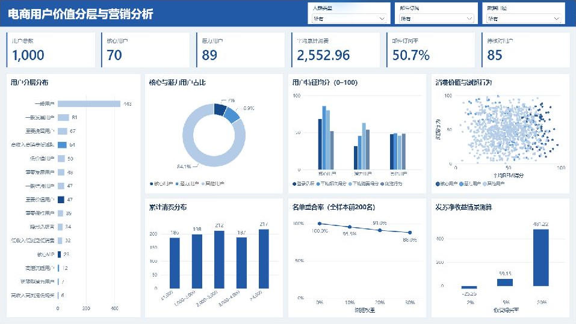

# 电商用户价值分层与营销策略分析

基于 1,000 名用户的消费、登录和浏览数据，使用 Python、SQL 完成用户分层、浏览权重比较和营销收益测算，并制作 Power BI 与 HTML 看板。

[项目报告](report/项目报告.md) · [分析代码](code/) · [A/B 实验设计](report/实验设计.md)

## 看板

| Power BI 制作版 | HTML 交互版 · AI 协助制作 |
|---|---|
|  |  |
| [下载 Power BI 文件](dashboard/电商用户分析_PowerBI.pbix?raw=true) | [下载 HTML 文件](dashboard/电商用户分析_HTML.html?raw=true) |

Power BI 文件用 Power BI Desktop 打开，HTML 文件下载后用浏览器打开。

## 主要结果

- 全量样本分为核心用户 70 人、潜力用户 89 人、其他用户 841 人。
- 排除购买频次为 0 且累计消费大于 0 的 85 人后，对剩余 915 人重新评分，其中 43 人的细分标签发生变化。
- 固定选取前 200 人，浏览加权幅度设为 20% 时替换 18 人。入选用户的平均浏览得分由 48.83 升至 53.07，平均累计消费由 4,117.73 变为 4,084.86。

## 收益测算

选取 89 名潜力用户，客单价采用样本均值 104.039。自然购买率设为 1%，毛利率 40%，券额 10，每人联系成本 0.5。

| 发券后购买率 | 测算增量净收益 |
|---|---:|
| 2% | −25.26 |
| 5% | 59.15 |
| 20% | 481.22 |

测算的盈亏平衡购买率为 **2.90%**。参数和计算过程见 [收益情景测算](code/收益情景测算.ipynb)。

## 代码

| 文件 | 内容 |
|---|---|
| [用户分层分析.ipynb](code/用户分层分析.ipynb) | 数据检查、特征分析、评分与分层、排除 85 人后的重算比较 |
| [SQL与权重分析.ipynb](code/SQL与权重分析.ipynb) | SQL 汇总、前 200 名查询、浏览权重比较 |
| [收益情景测算.ipynb](code/收益情景测算.ipynb) | 三档购买率情景、盈亏平衡、券额与毛利率比较、两种选人策略测算 |

## 运行

在项目目录安装依赖并启动 Jupyter：

```bash
python -m pip install -r requirements.txt
jupyter lab
```

打开 `code/`，先运行用户分层分析，再运行收益情景测算。SQL 与权重分析读取 `outputs/baseline/user_segments.csv`，可独立运行。

## 数据与参考

数据集：[Ecommerce Product Recommendation Collaborative](https://www.kaggle.com/datasets/kartikeybartwal/ecommerce-product-recommendation-collaborative) · [数据字典](data/data_dictionary.xlsx) · [数据许可](data/LICENSE.txt)

参考视频：[小马上学数分：数据分析实战项目](https://www.bilibili.com/video/BV1DkPcz7Esa/)
