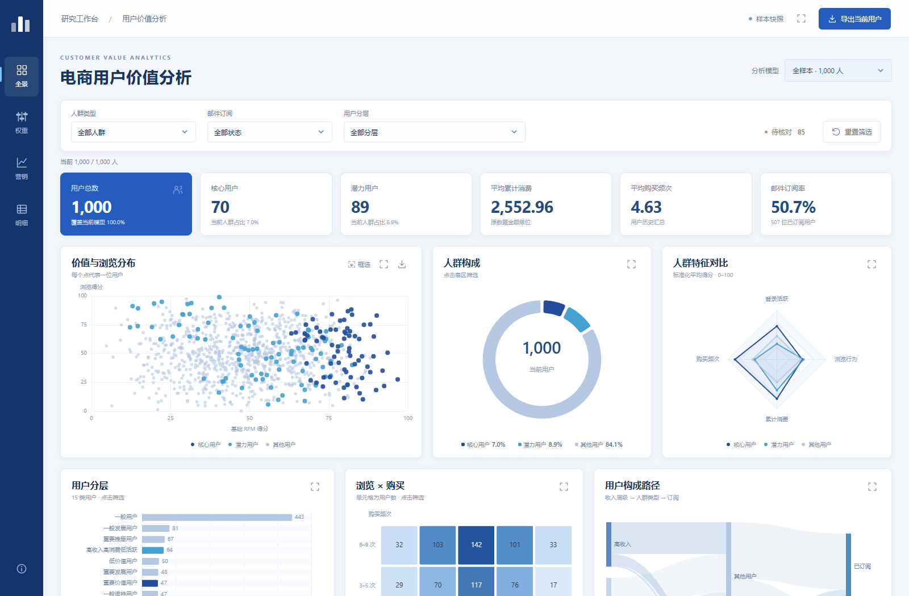

# 电商用户价值分层与营销策略分析

基于 1,000 名用户的消费、登录和浏览记录，建立用户分层规则，比较不同筛选策略，并用交互看板展示分析结果。

**Python · SQL · Power BI · ECharts**



[项目报告](reports/project_report.md) · [分析 Notebook](notebooks) · [HTML 看板](dashboard/index.html) · [Power BI 文件](powerbi/README.md) · [实验设计](reports/ab_experiment_design.md)

> HTML 看板下载后双击即可使用，不需要联网。GitHub 文件页展示的是源码；在线预览地址将在部署后补充。

## 项目解决什么问题

面对一份用户汇总表，如何找到值得进一步运营的人群？本项目围绕三个问题展开：

1. 用户分层结果是否受数据口径影响？
2. 在消费表现之外加入浏览行为，会怎样改变入选名单？
3. 如果向目标用户发券，购买率需要提升到什么程度才可能划算？

## 主要发现

| 问题 | 分析结果 | 对策略的影响 |
|---|---|---|
| 数据口径 | 85 名用户购买频次为 0，但累计消费大于 0；排除后重新计算，保留的 915 名用户中有 43 人标签变化 | 先核对统计周期，并保留全量与重算两套结果 |
| 权重选择 | 固定选取 200 人，浏览加权幅度为 20% 时，18 人被替换；平均浏览分由 48.83 升至 53.07，平均累计消费由 4,117.73 降至 4,084.86 | 增加浏览权重会改变候选人群，不能直接等同于营销效果更好 |
| 发券条件 | 对 89 名潜力用户，在自然购买率 1%、客单价 104.039、毛利率 40%、券额 10、联系成本 0.5 的假设下，活动购买率约需达到 2.90% 才收支平衡 | 优先验证购买率提升和真实成本，不能仅凭用户评分决定投放 |

金额沿用数据原单位。以上分层统计来自公开样本；购买率、成本与利润结果属于情景测算。

## 完成的分析

- **数据检查**：核对用户粒度、缺失、重复及消费字段口径，保留待核对记录。
- **用户分层**：以最近登录、购买频次、累计消费和浏览行为建立评分及规则标签，得到核心 70 人、潜力 89 人、其他 841 人。
- **敏感性分析**：重新计算排除待核对记录后的标签；固定入选人数，比较 0%、10%、20%、30% 浏览加权幅度。
- **SQL 查询**：完成分层汇总、基础分前 200 名筛选，以及实验候选用户提取。
- **收益测算**：分别计算增量销售额、毛利、核销成本和联系成本，展示正负收益情景及两种策略的假设比较。
- **可视化交付**：提供蓝白风格 HTML 交互看板和可编辑 Power BI 单页报告。
- **实验方案**：设计邮件发券 A/B 实验，明确随机分组、14 天观察窗口、购买率、净贡献和样本量。

## 看板可以做什么

HTML 看板包含用户概览、人群构成、消费分布、评分分布、行为散点、用户画像、权重比较和收益情景等内容，支持：

- 切换全量样本与排除 85 人后重新计算的样本；
- 按人群、订阅状态等条件筛选，查看联动图表和用户明细；
- 框选散点、调整权重与成本参数，比较入选名单和预计收益；
- 导出明细 CSV 和图表图片，离线查看完整页面。

HTML 操作说明见 [dashboard/README.md](dashboard/README.md)。Power BI 使用原生视觉对象，适合展示总体分层、评分、权重与情景结果，见 [powerbi/README.md](powerbi/README.md)。

## 如何运行

已附分析结果、执行后的 Notebook 和可直接打开的看板。只查看作品不需要安装 Python。

需要重新计算时，在项目根目录打开终端：

```bash
python -m venv .venv
# Windows PowerShell 激活环境：
.venv\Scripts\Activate.ps1
python -m pip install -r requirements.txt
python run_analysis.py
```

上述命令依次生成数据检查、用户分层、SQL 结果、权重比较、收益测算、报告插图和 `dashboard/index.html`。本项目已在 Python 3.14.6 环境验证；建议使用相同版本复现。

逐步阅读分析过程：

```bash
jupyter lab
```

按 `notebooks/01` 至 `04` 的顺序阅读。也可以运行：

```bash
python scripts/reproduce_notebooks.py
python -m unittest discover -s tests
```

收益假设放在 [configs/scenarios.json](configs/scenarios.json)。分层规则与权重定义见 [模型说明](reports/model_definition.md)。修改假设后重新运行分析即可更新结果；报告中的文字结论需要根据新结果同步调整。

## 目录

```text
ecommerce-customer-segmentation/
├── README.md                 项目介绍与运行入口
├── data/                     原始数据、字段字典、来源记录
├── notebooks/                四份按分析顺序组织的 Notebook
├── src/                      分层、情景计算与绘图代码
├── sql/                      可执行 SQL 查询
├── configs/                  情景参数
├── outputs/                  分层名单、对照结果与测算表
├── reports/                  项目报告、模型说明、实验设计与插图
├── dashboard/                HTML 看板、源码与本地图表库
├── powerbi/                  可编辑 Power BI 项目
├── scripts/                  Notebook 复现工具
├── tests/                    关键计算检查
├── requirements.txt          Python 环境
└── THIRD_PARTY_NOTICES.md     数据与第三方库说明
```

## 数据与分析边界

数据来自 Kaggle 的 [Ecommerce Product Recommendation Collaborative](https://www.kaggle.com/datasets/kartikeybartwal/ecommerce-product-recommendation-collaborative)，发布者为 `kartikeybartwal`，包含 1,000 行用户汇总记录、14 个业务字段。下载时的许可与文件校验记录见 [数据说明](data/README.md)。

这份数据没有逐笔订单、活动分组、发券或活动后购买记录。因此，当前作品交付的是**规则分层、稳健性检查、情景测算和待执行实验设计**。最近登录被用作活跃度代理，不能当作最近购买时间；用户得分也不是购买概率。项目没有训练推荐模型，也没有验证线上转化提升。
