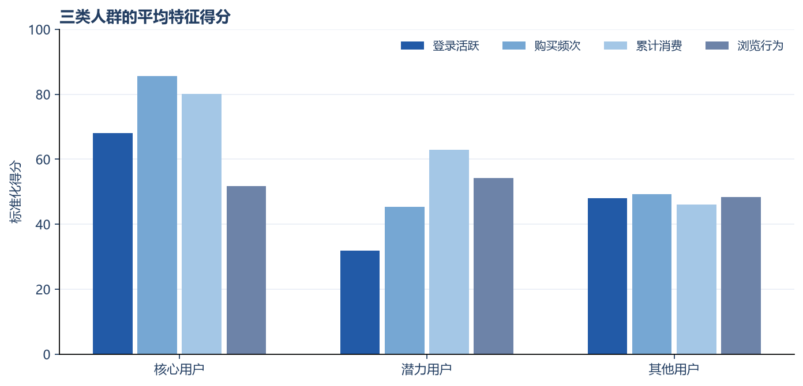
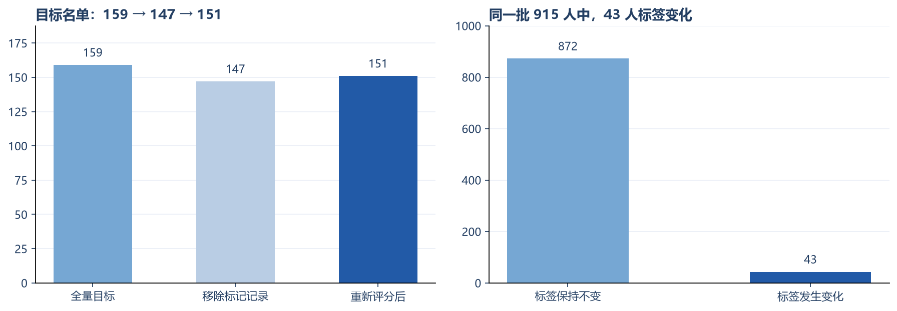
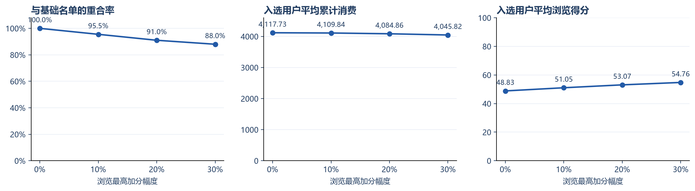
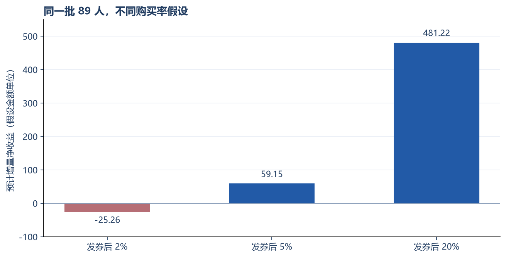

# 电商用户价值分层与营销策略分析报告

## 1. 分析目标

本项目使用 1,000 名用户的公开汇总数据，探索如何从用户的消费表现和浏览行为中筛选运营候选人群，并判断发券活动需要满足哪些条件才可能带来增量收益。

分析依次回答：数据是否足以支持分层、分层结果是否稳定、浏览权重如何影响名单，以及后续如何验证营销策略。

## 2. 数据检查与处理

原始表一行代表一名用户，删除导出的行号列后有 14 个业务字段，涵盖用户属性、登录、消费、浏览和邮件订阅。用户 ID 唯一，未发现缺失单元格；最近登录天数范围为 1—29。

检查发现 **85 人的购买频次为 0，但累计消费大于 0**。由于数据说明没有给出两个字段的统计周期，不能仅凭这一组合判断记录错误。本项目保留原记录并加上待核对标记，同时建立一套排除这些记录后的敏感性分析。

| 样本口径 | 用户数 | 待核对人数 | 平均累计消费 | 平均浏览得分 |
|---|---:|---:|---:|---:|
| 全量样本 | 1,000 | 85 | 2,552.96 | 49.12 |
| 排除后重新计算 | 915 | 0 | 2,542.17 | 49.03 |

币种、消费字段的统一统计周期和数据采集方式未得到确认。金额按原数据单位展示，不据此推断实际企业收入。

## 3. 评分和分层方法

将最近登录天数反向归一化为 R，将购买频次、累计消费正向归一化为 F、M；浏览时长与浏览页数分别归一化后取平均，得到 I。各项基础特征范围为 0—100。

```text
RFM 基础分 = 0.2 × R + 0.3 × F + 0.5 × M
浏览得分 I = 0.5 × 归一化浏览时长 + 0.5 × 归一化浏览页数
综合分 = RFM 基础分 × (1 + 浏览加权幅度 × I / 100)
```

R 使用的是最近登录信息，属于活跃度代理，并非传统 RFM 的最近购买时间。权重是本项目的规则设定，没有用营销结果训练或校准。

评分用于排序；分层标签由有先后顺序的条件规则决定，并非按综合分直接切成几档。详细阈值与覆盖顺序见 [模型说明](model_definition.md)。

全量样本得到 15 种细分标签，再归为三个便于展示和比较的组：

| 组别 | 人数 | 占比 | 平均累计消费 | 平均购买频次 | 平均浏览得分 |
|---|---:|---:|---:|---:|---:|
| 核心 | 70 | 7.0% | 4,029.59 | 7.70 | 51.75 |
| 潜力 | 89 | 8.9% | 3,183.54 | 4.08 | 54.14 |
| 其他 | 841 | 84.1% | 2,363.32 | 4.43 | 48.36 |



核心人群的历史消费和购买频次更高，这与分层使用这些字段有关。潜力组汇集了几类值得进一步检查的用户，“潜力”是规则标签，尚无证据证明其优惠券响应更强。“其他”表示不属于上述两组，不等于没有业务价值。

## 4. 数据口径对结果的影响

排除 85 人后，从原始字段重新计算归一化、收入分位数及分层阈值，而不是简单删除已评分表中的记录。

在共同保留的 915 人中，**43 人的细分标签发生变化，占 4.70%**。核心与潜力合计在全量样本中为 159 人，其中 12 人被标记排除，剩下 147 人；重新评分后有 4 人进入目标组、无人离开，最终为 151 人。



这说明样本变化既影响覆盖人数，也会通过分位数阈值改变部分保留用户的标签。真实业务上线前，应核对购买频次与累计消费的周期，并固定评分参考范围和阈值更新频率。当前保留两套口径，便于读者观察这一影响。

## 5. 浏览权重如何改变入选名单

为了单独观察权重的影响，固定使用全量 1,000 人，每种规则均选前 200 人，同分按用户 ID 排序。

| 浏览加权幅度 | 与基础名单重合率 | 替换人数 | 平均累计消费 | 平均浏览得分 |
|---|---:|---:|---:|---:|
| 0% | 100.0% | 0 | 4,117.73 | 48.83 |
| 10% | 95.5% | 9 | 4,109.84 | 51.05 |
| 20% | 91.0% | 18 | 4,084.86 | 53.07 |
| 30% | 88.0% | 24 | 4,045.82 | 54.76 |



20% 加权使 18 名浏览表现更突出的用户进入名单，同时平均累计消费略有下降。这体现了消费表现和浏览行为之间的取舍。它不能证明 20% 是最优权重；要决定运营中采用哪一档，还需要活动结果或后续购买数据。

## 6. 发券收益的情景测算

选择全量样本中的 89 名潜力用户作为测算对象。人数和平均订单金额来自数据；自然购买率、活动购买率、毛利率和成本均为假设。

固定假设为：自然购买率 1%，客单价 104.039，商品毛利率 40%，每次核销优惠额 10，每位联系用户成本 0.5。每位购买用户只下一单并核销一次，客单价与毛利率均按优惠前口径计算。

```text
增量销售额 = 人数 × (活动购买率 − 自然购买率) × 客单价
增量毛利 = 增量销售额 × 毛利率
优惠成本 = 人数 × 活动购买率 × 每次核销优惠额
联系成本 = 人数 × 每人联系成本
增量净收益 = 增量毛利 − 优惠成本 − 联系成本
ROI = 增量净收益 / (优惠成本 + 联系成本)
```

优惠成本覆盖活动组所有购买用户，其中也包括原本就会购买的人。分母为零时，ROI 不定义。

| 假设活动购买率 | 相对自然购买率的绝对提升 | 预计增量净收益 |
|---|---:|---:|
| 2% | 1 个百分点 | −25.26 |
| 5% | 4 个百分点 | 59.15 |
| 20% | 19 个百分点 | 481.22 |



在这组固定成本和毛利率下，活动购买率的盈亏平衡点约为 **2.90%**。购买率从 1% 提高到 2% 仍可能亏损，说明“购买率提升”和“值得投放”需要分别判断。20% 仅用于展示较高提升情景，不代表预测值。

项目还比较了基础分前 200 人与核心加潜力 159 人。在核心、潜力和其他人群分别使用同一组公共响应假设后，两种策略的预计净收益为 99.96 与 381.87，预计成本为 677.00 与 467.50。**这个差异由人群构成和响应假设共同决定**，且两方案覆盖人数不同，不能据此声称分层策略已产生更高实际收益。计算过程及参数见 [收益测算 Notebook](../code/04_profit_scenarios.ipynb)。

## 7. 后续实验如何验证

设计向潜力用户发送优惠券邮件的随机对照实验：按用户固定分组，一组维持现状，一组收到邮件加券，统一观察 14 天，比较全部被分配用户的购买率与人均净贡献。

在自然购买率 1%、目标购买率 2%、双侧显著性水平 5%、功效 80% 的假设下，简化近似估算约需每组 2,320 人。排除待核对记录并重新评分后，符合“潜力＋已订阅邮件”的样本只有 40 人，且缺少真实触达和后续订单。因此当前交付为 [待执行实验设计](ab_experiment_design.md)，未生成或伪造实验结果。

实验验证的是邮件与优惠券的组合效果。如果需要单独区分邮件提醒和价格优惠的作用，应另设实验方案。

## 8. 作品交付与适用范围

本项目的检查、分层、SQL 查询、敏感性分析与情景测算可通过分析代码复现。HTML 看板支持样本切换、交互筛选和参数调整；Power BI 文件提供可编辑的单页展示。

目前适合展示从数据检查到策略论证的分析过程。要转为真实运营应用，还需补充统一统计周期、订单明细、成本、分组与触达记录，以及完整观察窗口内的购买和退款数据，再校准标签、权重及收益假设。
